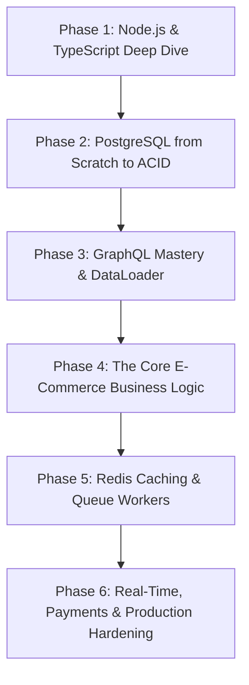

Viewed plan.md:1-101
Viewed .md:1-36

Here is a complete, structured master plan designed specifically to take you from your current level to mastering **Node.js**, **PostgreSQL (from zero)**, and **GraphQL** by building an enterprise-grade e-commerce backend.

I have updated your roadmap into a structured 6-phase curriculum where every concept is learned through direct hands-on practice.

---

# 🗺️ Master Curriculum: The E-Commerce Backend Engine



---

## Phase 1: Node.js & TypeScript Mastery (The Foundation)
*Goal: Understand how Node.js actually executes code, master async programming, and establish a bulletproof backend architecture.*

### 1. What You Will Learn:
* **The Node.js Runtime & Event Loop:** How V8 + Libuv work, Call Stack, Microtask queue (`Promise`), Macrotask queue (`setTimeout`, `setImmediate`), and why blocking the thread kills performance.
* **Modern TypeScript Backend Architecture:** Layered / 3-tier architecture:
  * **Controllers / Resolvers:** Handle HTTP/GraphQL inputs and responses.
  * **Services:** Pure business logic (tax calculation, discounts, checkout).
  * **Repositories / Data Access:** Database communication.
* **Error Handling & Validation:** Centralized custom error classes (`AppError`, `NotFoundError`, `UnauthorizedError`) and request payload validation with **Zod**.
* **Configuration & Environment:** Type-safe environment variables (`dotenv` + Zod schema validation).

### 2. What We Build in this Phase:
* A production-ready Express + TypeScript application template with health check, request logger middleware (Morgan/Pino), and a global error handling middleware.

---

## Phase 2: PostgreSQL From Scratch (Zero to Relational Modeling)
*Goal: Learn SQL and relational databases from the ground up, then master schema design, transactions, and locking.*

### 1. What You Will Learn:
* **PostgreSQL Fundamentals:**
  * Setting up local PostgreSQL via Docker Compose (or cloud like Neon).
  * Relational concepts: Primary Keys (`UUID` vs `BIGSERIAL`), Foreign Keys, `NOT NULL`, `UNIQUE`, `CHECK` constraints, cascades (`ON DELETE CASCADE`).
* **Writing Raw SQL:**
  * `SELECT`, `INSERT`, `UPDATE`, `DELETE`, filtering (`WHERE`, `LIKE`, `ILIKE`).
  * Table relationships & JOINs: `INNER JOIN`, `LEFT JOIN`, `FULL JOIN`, Aggregations (`GROUP BY`, `COUNT`, `SUM`).
* **E-Commerce Data Modeling:**
  * `users` (id, email, password_hash, role)
  * `categories` & `products` (title, description, price, sku, status)
  * `product_variants` (size, color, price_modifier)
  * `inventory` (variant_id, quantity, reserved_quantity)
  * `orders` & `order_items`
* **Performance & Safety:**
  * Indexes: When to use B-Tree indexes, compound indexes, and GIN indexes (for search).
  * `EXPLAIN ANALYZE`: Reading query execution plans to identify bottlenecks.
* **Modern ORM / Query Builder:**
  * Introducing **Drizzle ORM** or **Prisma** (we will use Drizzle or Prisma to write type-safe queries and manage database migrations).
* **Concurrency & ACID Transactions:**
  * What is ACID (Atomicity, Consistency, Isolation, Durability)?
  * Row-level locking (`SELECT ... FOR UPDATE`) to prevent overselling the last item in a flash sale.

---

## Phase 3: GraphQL Mastery (Deep-Dive)
*Goal: Understand the philosophy of GraphQL, implement a typed schema, write resolvers, and eliminate performance pitfalls.*

### 1. What You Will Learn:
* **GraphQL vs REST:**
  * Under-fetching & Over-fetching: Why mobile/web clients love GraphQL.
  * Single endpoint (`/graphql`) over POST vs many REST endpoints.
  * The GraphQL execution lifecycle (Parse -> Validate -> Execute).
* **Schema Definition Language (SDL) & Type System:**
  * Scalar types (`Int`, `Float`, `String`, `Boolean`, `ID`), custom scalars (`DateTime`, `JSON`).
  * Object types, Enums, Inputs (`input ProductInput`), Unions, Interfaces.
* **Operations:**
  * **Queries:** Reading catalog, fetching user profile, searching.
  * **Mutations:** Creating items, updating cart, placing an order.
  * **Subscriptions:** Real-time updates over WebSockets.
* **Resolvers & Execution Pipeline:**
  * The 4 resolver arguments: `(parent, args, context, info)`.
  * Context injection: Passing authenticated user, database instance, and loaders.
* **The Infamous N+1 Problem & `DataLoader`:**
  * Why nested GraphQL queries can execute 1,000 SQL queries instead of 2.
  * Using Facebook's **`DataLoader`** to batch and cache database requests automatically in-memory per request.

### 2. What We Build in this Phase:
* Mount an **Apollo Server** or **GraphQL Yoga** instance directly onto our Express application so both REST (for webhooks/health) and GraphQL (for client apps) coexist peacefully.

---

## Phase 4: Core E-Commerce Domain Engine
*Goal: Combine Node.js, Postgres, and GraphQL to build the business logic.*

### 1. What We Build:
* **Authentication & Authorization (AuthN & AuthZ):**
  * Password hashing with `bcrypt` / `argon2`.
  * Stateless JWT authentication with access + refresh token rotation.
  * Role-Based Access Control (`ADMIN`, `CUSTOMER`, `SELLER`) in GraphQL resolver directives / middleware.
* **Product Catalog & Full-Text Search:**
  * Filter by category, price range, and availability.
  * Cursor-based pagination (`first`, `after`) for infinite scroll.
* **In-Memory Cart with Redis:**
  * Why carts belong in Redis (fast in-memory read/writes with 7-day TTL) instead of hammering PostgreSQL.
  * Atomic operations with Redis hashes (`HSET`, `HGETALL`, `HDEL`).
* **Checkout & Inventory Row-Locking:**
  * Convert a Redis cart into a PostgreSQL `Order`.
  * Execute a transactional stock deduction:
    ```sql
    BEGIN;
    SELECT quantity FROM inventory WHERE product_id = $1 FOR UPDATE;
    -- Verify enough stock exists, then:
    UPDATE inventory SET quantity = quantity - $2 WHERE product_id = $1;
    INSERT INTO orders ...;
    COMMIT;
    ```

---

## Phase 5: High-Concurrency, Payments & Queues
*Goal: Protect the Node.js event loop under heavy loads.*

### 1. What You Will Learn:
* **Stripe Payment Integration:**
  * Creating payment intents.
  * Verifying raw cryptographic Stripe Webhook signatures (REST endpoint).
* **Message Queues with BullMQ + Redis:**
  * Why you must **never** send emails or generate PDF invoices inside the request-response lifecycle.
  * Dispatching jobs into BullMQ queues in <5ms.
* **Background Worker Process:**
  * Creating an isolated worker thread or dedicated worker process (`src/workers/orderWorker.ts`) to consume jobs, send transactional emails (Resend/Nodemailer), and update order status.

---

## Phase 6: Real-Time Subscriptions & Production Hardening
*Goal: Polish to enterprise quality.*

### 1. What We Build:
* **GraphQL Subscriptions (WebSockets):**
  * Real-time order tracking (`orderStatusUpdated(orderId)`).
  * Real-time inventory counter for live stock alerts.
* **Security & Performance:**
  * Rate limiting (Redis-based sliding window).
  * Query depth & complexity limiting (protecting your GraphQL endpoint from malicious recursive queries).
  * Helmet, CORS configuration, and Docker containerization (`Dockerfile` & `docker-compose.yml`).

---

# 🚀 Next Step: How We Start

We take this one concept at a time so you never feel lost:

1. **Step 1:** We'll finalize the Node.js + Express setup in your current files and install our core tools.
2. **Step 2:** We will set up **PostgreSQL** (via a local Docker container or free Neon cloud database) and learn SQL syntax together with practical examples.
3. **Step 3:** We will integrate **GraphQL** and see how a query pulls data directly from Postgres.

Let's update [`backend/plan.md`](file:///c:/Code/NEXT/v-commerce/backend/plan.md) with this detailed plan. Do you prefer running **PostgreSQL locally with Docker**, or using a **free cloud Postgres service** (like Neon or Supabase)?